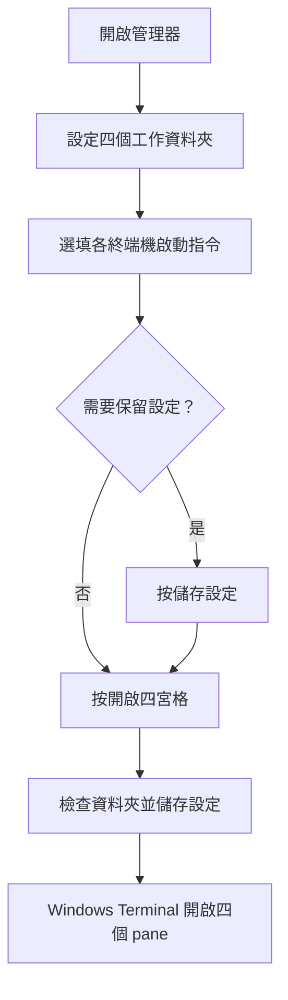

# Windows Terminal 四宮格管理器使用手冊

Windows Terminal 四宮格管理器可一次開啟四個 Windows Terminal pane，並為每個 pane 指定工作資料夾與選用的 AI Coding CLI 啟動指令。設定會保存在本機 JSON 檔案，不會上傳。

## 目錄

- [快速開始](#快速開始)
- [使用流程](#使用流程)
- [操作介面](#操作介面)
- [設定保存與備份](#設定保存與備份)
- [隱私與資料安全](#隱私與資料安全)
- [常見問題](#常見問題)
- [維護者：建置執行檔](#維護者建置執行檔)

## 快速開始

### 使用免安裝執行檔

1. 開啟 `dist` 資料夾。
2. 執行 `Open4Terminals.exe`。
3. 確認電腦已安裝 Windows Terminal。

執行檔已包含 Python 執行環境，不需要另外安裝 Python。Windows Terminal 仍須另外安裝，管理器會透過 `wt.exe` 開啟終端機。

### 從原始碼啟動

執行 `Run_Terminal_Manager.bat`。此方式需要 Windows、Python 3.9 以上版本及 Windows Terminal；管理器本身不需要額外安裝 Python 套件。

## 使用流程



## 操作介面

每個「終端機」區塊包含兩個欄位：

- **工作資料夾**：輸入資料夾路徑，或按「瀏覽...」選取。啟動前管理器會確認資料夾存在。
- **啟動指令**：指定要在該終端機執行的指令，例如 `codex`、`opencode` 或 `agy`。可留空；留空時會在指定資料夾開啟命令提示字元。

按鈕用途：

- **儲存設定**：立即保存四組路徑、指令及版面比例。
- **清除啟動指令**：清空四組啟動指令，不會清除工作資料夾。
- **開啟四宮格**：先檢查四個工作資料夾，再保存目前設定並啟動 Windows Terminal。

四個 pane 依閱讀順序排列：終端機 1 左上、2 右上、3 左下、4 右下。表單區域可垂直捲動；按鈕固定在視窗底部。

## 設定保存與備份

設定檔名稱為 `open_4_terminals.json`，放在啟動中的程式旁：

- 使用 `Open4Terminals.exe` 時，設定檔在執行檔所在資料夾（目前為 `dist`）。
- 使用 `Run_Terminal_Manager.bat` 或直接執行 Python 程式時，設定檔在專案程式所在資料夾。

兩種啟動方式使用各自資料夾中的設定檔，因此切換方式時設定可能不同。要備份或移到另一個位置，請複製 `open_4_terminals.json`，並將它放在新的執行檔旁。舊版使用者目錄中的 `.open_4_terminals.json` 會在新版第一次啟動時匯入；原檔會保留。

管理器會在啟動四宮格前自動保存設定。設定檔也可手動複製作為備份：


## 隱私與資料安全

設定檔會記錄工作資料夾完整路徑及啟動指令。這些資料保存在本機；分享設定檔前，請先確認內容沒有不想公開的路徑或指令。專案的 `.gitignore` 已排除 `open_4_terminals.json`，避免意外提交個人設定。

## 常見問題

### 按「開啟四宮格」後提示資料夾不存在

確認四個工作資料夾都存在，並檢查磁碟代號、資料夾名稱及路徑拼字。可用「瀏覽...」重新選取。

### 提示找不到 Windows Terminal

安裝 Windows Terminal，並確認 `wt.exe` 可從命令提示字元或 PowerShell 執行。管理器會先從 PATH 尋找，再檢查 Windows App Execution Alias。

### 終端機沒有執行啟動指令

確認指令已安裝，且可在命令提示字元中執行。啟動指令會交給 `cmd.exe /k` 執行；留空則只會開啟命令提示字元。

### 視窗底部按鈕或部分欄位看不到

管理器會依螢幕高度設定初始視窗高度。若表單超出可用高度，使用表單右側捲軸；底部操作按鈕固定顯示。

### 設定沒有載入

確認你開啟的是原本使用的啟動方式，並檢查該程式旁是否有 `open_4_terminals.json`。原始碼版與執行檔版的設定檔位置不同。

## 維護者：建置執行檔

需要 Python 與 PyInstaller。若環境尚未安裝 PyInstaller，可執行：

```powershell
python -m pip install pyinstaller
```

之後雙擊 `Build_Executable.bat`，或在專案資料夾執行：

```powershell
python -m PyInstaller --noconfirm --clean --onefile --windowed --name Open4Terminals open_4_terminals.py
```

建置完成後，執行檔會位於 `dist\Open4Terminals.exe`。目前建置為 Windows GUI 單檔；打包和啟動流程未在此手冊編輯工作中重新驗證。
